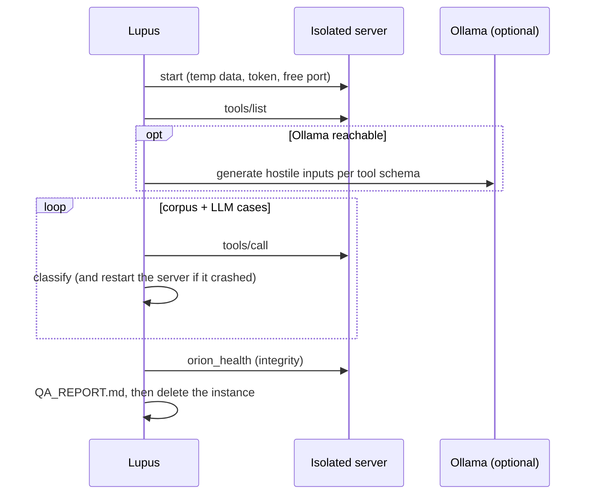

<p align="center">
  
</p>

<p align="center">
  
  
  
  
  
  
</p>

---

Test suite for the **universo** MCP ecosystem. Validates servers at the protocol,
functional, contract, persistence and performance level, plus adversarial testing
with a built-in attack corpus and an optional local LLM.

**Lupus never touches real data.** For every run it launches its own instance of the
server under test with a temporary data directory, a random bearer token and a free
port, and deletes everything afterwards.

| 🔌 Protocol | ⚙️ Functional | 📜 Contracts | 💾 Persistence | ⚡ Performance | 🐺 Attack |
|:---:|:---:|:---:|:---:|:---:|:---:|
| JSON-RPC, auth | every tool | invalid & hostile input | restarts, concurrency | p95 latency | crashes, leaks, corruption |

## Quick start

```bash
# Orion must be installed next to Lupus (../orion/.venv/bin/orion)
cd ~/Proyectos/universo/lupus
uv venv && uv pip install -e '.[dev]'

.venv/bin/python lupus_cli.py run -q          # all layers (~20 s)
.venv/bin/python lupus_cli.py attack          # adversarial run (Ollama optional)
.venv/bin/python lupus_cli.py report          # latest TEST_REPORT.md
.venv/bin/python lupus_cli.py report --qa     # latest QA_REPORT.md
```

`./run_tests.sh` wraps the same commands (`--layer`, `--attack`, `--report`).

## CLI

```bash
lupus run                          # all 5 layers
lupus run --layer contracts        # one or more layers, comma-separated
lupus run -v -x                    # verbose, stop on first failure
lupus attack                       # corpus + LLM cases for every tool
lupus attack --tools recall_context,update_profile --count 8
lupus report [--qa]
```

`lupus attack` exits with status 1 when it finds a vulnerability, so it can gate CI.

## Test layers

| # | Layer | Mark | What it proves |
|---|-------|------|----------------|
| 1 | 🔌 Protocol | `protocol` | Valid JSON-RPC errors, standard codes, bearer token enforced (401), tool metadata |
| 2 | ⚙️ Functional | `functional` | CRUD, search, project scoping, graph and cascades, sessions, profile, health |
| 3 | 📜 Contracts | `contracts` | Unknown ids are tool errors, schema limits, hostile strings stored verbatim |
| 4 | 💾 Persistence | `persistence` | Data survives a server restart; 5 concurrent clients lose no write |
| 5 | ⚡ Performance | `performance` | 100 writes < 20 s; p95 < 500 ms for search, browse, recall, whoami on 200 entries |

Tests are deterministic: each one works in its own randomly named project and
asserts on structured output, never on prose.

## Adversarial testing



| Verdict | Meaning |
|---------|---------|
| ✅ accepted | Tool succeeded — hostile text stored verbatim is fine |
| 🛡️ rejected | Tool error — invalid input refused |
| 🐢 slow | Answered after more than 3 s (warning) |
| 🚨 vulnerability | Server crash, transport/protocol failure, leaked internals (tracebacks, paths, SQL errors) or failed integrity check |

**Score = cases without a vulnerability / total.** Model and endpoint:
`LUPUS_OLLAMA_MODEL` (default `llama3.2`), `LUPUS_OLLAMA_URL`.

## Configuration

```yaml
# config.yaml
servers:
  orion:
    command: ["../orion/.venv/bin/orion", "--transport", "http"]
    port_arg: "--port"           # Lupus appends: --port <free port>
    data_env: ORION_DATA_DIR      # receives a fresh temp dir
    token_env: ORION_TOKEN        # receives a random token
    env: { ORION_SEMANTIC: "off" }
    tools: [remember_decision, recall_context, ...]

  orion-live:                     # external server: only read-only layers run
    url: "http://127.0.0.1:9099/mcp"
    token_from: ORION_TOKEN
```

Tests that write data skip themselves on external servers, and `lupus attack`
refuses to run against one.

## Structure

```
lupus/
├── lupus_cli.py         # CLI: run · attack · report
├── lupus_server.py      # launches isolated server instances
├── attacker.py          # adversarial engine
├── report.py            # TEST_REPORT.md + shared rendering
├── conftest.py          # fixtures, call helpers, report hooks
├── config.yaml          # server registry
├── test_orion/          # layers 1–5 for Orion
├── test_shared/         # compliance checks for any MCP server
└── docs/assets/logo.svg
```

Generated reports (`TEST_REPORT.md`, `QA_REPORT.md`) are git-ignored.

---

<p align="center">
  <sub>Part of <a href="https://github.com/jdvalmart">universo</a> — constellatio Lupus, venator mendorum</sub>
</p>
