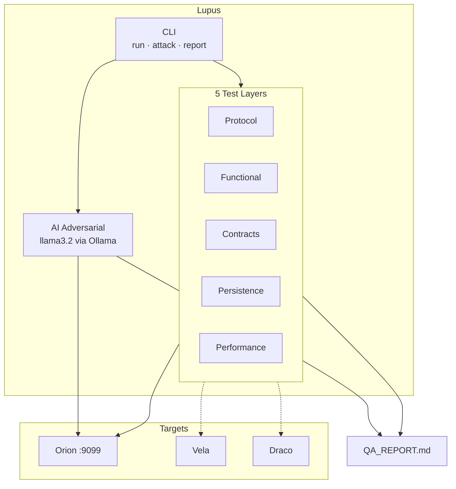
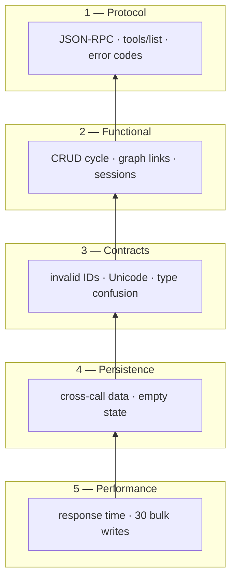
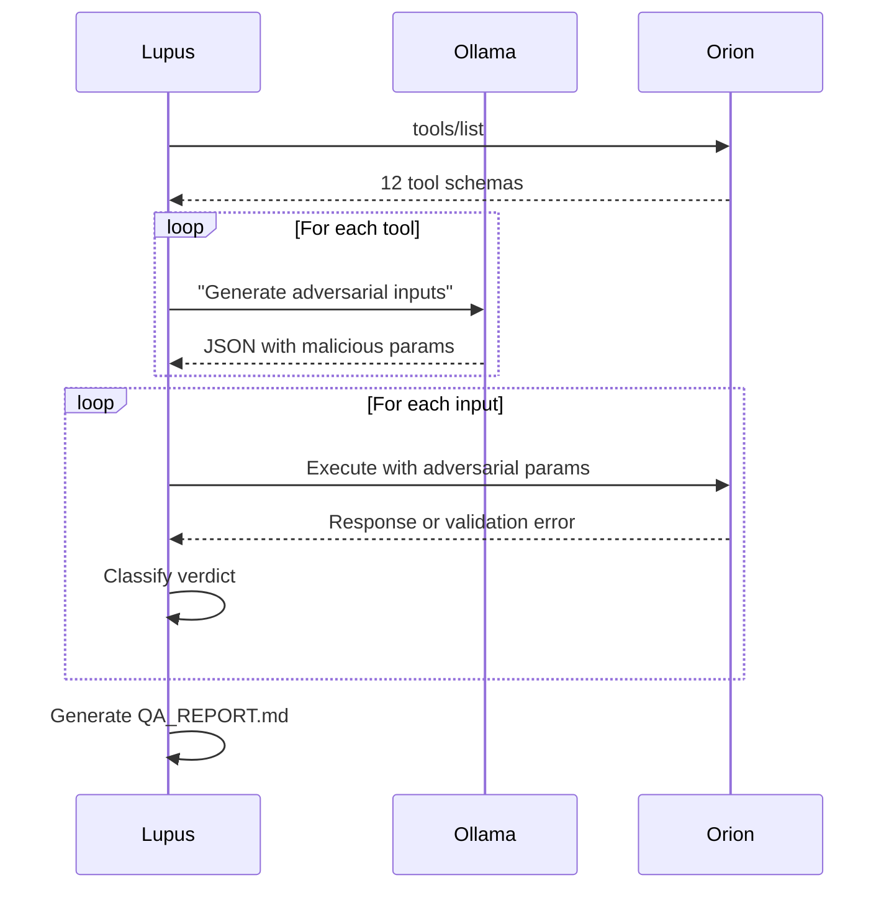

<p align="center">
  
</p>

<p align="center">
  
  
  
  
  
  
  
</p>

---

<br>

Test suite for the **universo** MCP ecosystem. Validates servers at the protocol,
functional, contract, persistence, and performance level — plus AI-powered
adversarial testing via local LLM.

 <br>

|  Protocol |  Functional |  Contracts |  Persistence |  Performance |  AI Attack |
|:---:|:---:|:---:|:---:|:---:|:---:|
| 7 tests | 13 tests | 10 tests | 3 tests | 5 tests | llama3.2 |

<br>

---



##   Quick start

```bash
# Clone & install
git clone https://github.com/jdvalmart/lupus && cd lupus
python -m venv .venv && source .venv/bin/activate
pip install pytest pytest-asyncio fastmcp pyyaml pydantic

# Make sure Orion is running
systemctl --user start orion

# Run the suite
python lupus_cli.py run -v

# AI-powered attack (needs Ollama)
ollama pull llama3.2
python lupus_cli.py attack
```

##   CLI commands

```bash
python lupus_cli.py run                    #   All 5 layers (36 tests)
python lupus_cli.py run --layer contracts  #   Single layer
python lupus_cli.py run -v -x              #   Verbose, stop on first failure

python lupus_cli.py attack                 #   AI adversarial (all 12 tools)
python lupus_cli.py attack --count 10      #   10 inputs per tool
python lupus_cli.py attack --tools recall  #   Specific tools only

python lupus_cli.py report                 #   Latest QA_REPORT.md
```

##   Getting started (step by step)

###  Prerequisites

| Requirement | How to check |
|-------------|--------------|
| Python 3.11+ | `python --version` |
| Orion running | `systemctl --user status orion` |
| Ollama (optional) | `ollama list` |

###  1. Clone and install

```bash
cd ~/Documentos/GitHub/universo
git clone https://github.com/jdvalmart/lupus
cd lupus
python -m venv .venv
source .venv/bin/activate
pip install pytest pytest-asyncio fastmcp pyyaml pydantic
```

###  2. Verify Orion is reachable

```bash
curl -s http://localhost:9099/mcp -X POST \
  -H "Content-Type: application/json" \
  -H "Accept: application/json, text/event-stream" \
  -d '{"jsonrpc":"2.0","id":1,"method":"tools/list","params":{}}' | head -c 100
```

###  3. Run the standard suite

```bash
python lupus_cli.py run -v
# Expected: 36 passed in ~15s
```

###  4. Run an adversarial attack (optional)

```bash
# Terminal 1: ollama serve
# Terminal 2:
python lupus_cli.py attack --tools whoami,recall_context --count 3
```

###  5. View the quality report

```bash
python lupus_cli.py report
# Or: cat QA_REPORT.md
```

###  Common issues

|  Problem |  Solution |
|---------|----------|
| `Connection refused` | Start Orion: `systemctl --user start orion` |
| `Missing session ID` | Orion must run HTTP mode: `python server.py --transport http` |
| `Ollama not running` | `ollama serve` in another terminal |
| `Module not found` | `source .venv/bin/activate` |
| `No QA report found` | Run `python lupus_cli.py attack` first |

##   Test layers



|  # |  Layer |  Mark |  Tests | What it validates |
|---|-------|------|-------|-------------------|
| 1 |  Protocol | `protocol` | 7 | JSON-RPC compliance, error codes, session negotiation |
| 2 |  Functional | `functional` | 13 | Every tool works — CRUD, graph, sessions, whoami |
| 3 |  Contracts | `contracts` | 10 | Non-existent IDs, empty strings, Unicode, boundary values |
| 4 |  Persistence | `persistence` | 3 | Data survives across calls, graceful empty state |
| 5 |  Performance | `performance` | 5 | Response times <1s, bulk writes scale linearly |
| — |  AI Adversarial | — | N | llama3.2 generates malicious inputs, attacker classifies |

##   Adversarial testing

`lupus attack` uses **llama3.2** to generate malicious inputs for every tool,
executes them, and produces `QA_REPORT.md`.



###  Verdict classification

|  Verdict |  Meaning |
|---------|---------|
| `passed` |  Input accepted, output correct |
| `rejected` |  Invalid input correctly refused — **defense, not a bug** |
| `vulnerability` |  Crash, data leak, or unexpected behavior |

> **Score = (passed + rejected) / total.** A server that rejects every malicious
> input without crashing scores 100%.

##   Configuration

```yaml
# config.yaml — add any MCP server
servers:
  orion:
    url: "http://localhost:9099/mcp"
    tools:
      - remember_decision
      - recall_context
      # ...
```

##   Structure

```
lupus/
├── lupus_cli.py            #   CLI entrypoint
├── attacker.py             #   adversarial engine
├── conftest.py             #   MCP client + Ollama fixtures
├── config.yaml             #   server registry
├── pyproject.toml          #   pytest configuration
├── test_orion/
│   ├── test_protocol.py    #   layer 1
│   ├── test_functional.py  #   layer 2
│   ├── test_contracts.py   #   layer 3
│   ├── test_persistence.py #   layer 4
│   └── test_performance.py #   layer 5
├── test_shared/
│   └── test_mcp_compliance.py
├── docs/assets/logo.svg    #   wolf logo
├── QA_REPORT.md            #   generated   (gitignored)
└── README.md
```

---

<p align="center">
  <sub>Part of <a href="https://github.com/jdvalmart">universo</a> — constellatio Lupus, venator mendorum</sub>
</p>
